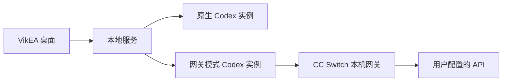
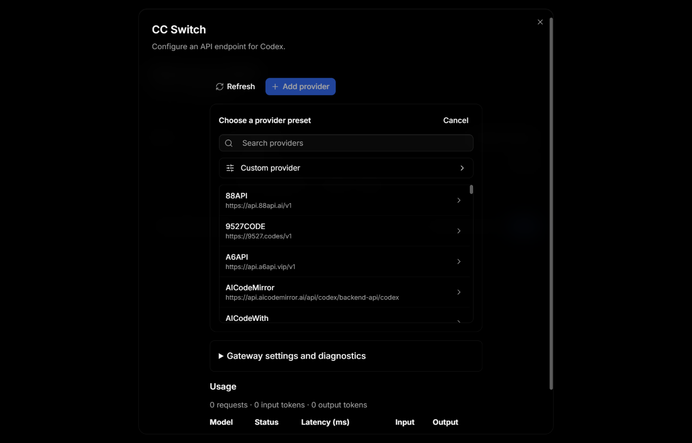

# VikEA 架构

VikEA 将三个独立的上游项目集成到一个桌面发行版中。各模块保留自己的依赖清单、锁文件和许可证。仓库根目录的 [package.json](../package.json) 编排 Windows 构建。

| 目录 | 在 VikEA 中的职责 |
| --- | --- |
| [src/t3code](../src/t3code) | Electron 桌面、Web 和移动端界面、本地服务、模型选择器和设备管理 |
| [src/cc-switch](../src/cc-switch) | API 供应商管理、协议转换、认证及用量统计 |
| [src/codex](../src/codex) | 本地编码代理运行时，支持原生账户模式和网关模式 |
| [src/build](../src/build) | 构建入口、运行时准备、源码结构检查与集成冒烟测试 |

两个 Codex 实例在模型选择器中独立展示。服务在 VikEA 数据根目录下为它们分配各自的运行目录。CC Switch 网关监听回环地址，Windows 凭据由 DPAPI 加密。

构建脚本将运行时和对应的许可文件暂存到 `.local/resources/`，生成 SHA-256 清单，随后由桌面打包脚本加入安装包。构建用法与第三方归属见 [项目 README](../README.md) 和 [LICENSE](../LICENSE)。

## Windows 首次配置

